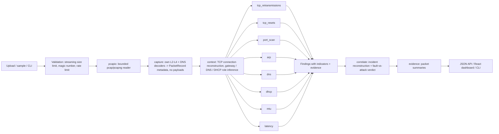

# NetSentinel

**Evidence-based network diagnosis from packet captures.** NetSentinel reads a pcap or pcapng
file and finds the faults and attacks in it. It groups related findings into incidents and
decides, with published rules, whether each incident looks like an ordinary fault or an
attack. Every conclusion is explained in plain language, with a likely cause, practical next
steps and the exact packets behind it.

> **Demo video:** https://drive.google.com/file/d/1d0C5AVouMivkO4rbuGsbvsih5I7EkG16/view?usp=sharing
>
> 
> **Deployed APP:** https://netsentinel-beta.vercel.app/

Built for the IIITDM Kancheepuram 24-hour Cybersecurity Hackathon (Network track: *Diagnosing
Network Problems from Packet Captures*).

---

## The problem

Small offices, labs and campus departments rarely have a network engineer. When the network
is slow or "broken", someone has to open a packet capture and read it line by line. That takes
deep protocol knowledge, and it is hardest to tell a **harmless fault** from an **attack
hiding in the same traffic**. People restart routers while a rogue device keeps redirecting
their traffic.

## The solution

NetSentinel turns a capture into a short list of **incidents**, each one answering:

- **What happened, when, and to which devices?** A reconstructed timeline built from real
  packets.
- **Is it a fault or an attack?** A verdict with the indicators that support it, how strong
  each one is, and the alternative explanations.
- **What is the likely cause, and what should I do?** Specific, ordered steps.
- **What can't the capture prove?** Limitations are stated, never hidden.
- **Where is the evidence?** Every packet is cited with the reason it was used, and packet
  numbers match Wireshark frame numbers.

### What makes it different

1. **Incident reconstruction engine.** Findings are linked only when a *documented
   cause-and-effect or attack-chain relationship* exists, the findings share a host, **and**
   they are close in time. A port scan, ARP poisoning and forged DNS answers from the same
   attacker become **one** attack story. An uplink outage that happens at the same time as an
   unrelated scan stays a **separate** fault incident. Being close in time is never enough on
   its own.
2. **Transparent fault-versus-attack reasoning.** There is no opaque score. Each finding lists
   indicators (for example "the RST's TTL differs from every other packet of that server") that
   point to *fault*, *attack* or *benign*, each with a strength. One published rule
   (`model.assess`) combines them. Side effects of an attack, such as the resets a scan
   provokes, are not reported as separate outages.
3. **Diagnoses that locate the problem.** NetSentinel works out whether the network or the
   server application is slow (fast handshake but slow first response). It works out whether
   loss happened before or after the capture point, and whether one server, the whole path or
   one client's link is affected. It tells a device replacement from a duplicate IP from ARP
   poisoning, and a DHCP relay from a rogue DHCP server. When the evidence supports it, it names
   the rogue device and the settings it handed out.
4. **Our own bounded parser.** Container framing (pcap and pcapng) and the
   Ethernet/VLAN/IPv4/IPv6/TCP/UDP/ICMP/ARP/DNS decoders are written for this project. They
   bounds-check every field: a 140-byte file that made the original prototype allocate 4 GB is
   now rejected with a warning. Parsing runs about 75,000 packets per second.

## Coverage of the official challenge points

| Challenge point | Status | Finding kinds |
|---|---|---|
| Read captures safely (large, broken, malicious) | Done, tested | Own bounded reader, limits, fuzz tests. See [docs/SECURITY.md](docs/SECURITY.md) |
| TCP retransmissions | Done, tested | `TCP_RETRANSMISSIONS`, `TCP_SYN_RETRIES` |
| TCP resets | Done, tested | `TCP_CONNECTION_REFUSED`, `TCP_CONNECTION_RESET` |
| DNS failures | Done, tested | `DNS_SERVER_UNRESPONSIVE`, `DNS_SERVER_FAILURE`, `DNS_NXDOMAIN` |
| Duplicate IP addresses | Done, tested | `DUPLICATE_IP` |
| ARP conflicts | Done, tested | `ARP_CONFLICT`, `ARP_MAPPING_CHANGED` (benign) |
| MTU mismatches | Done, tested | `MTU_ICMP_FRAG_NEEDED`, `MTU_BLACKHOLE_SUSPECTED` |
| Unusual delays | Done, tested | `SLOW_TCP_HANDSHAKE`, `SLOW_SERVER_RESPONSE`, `DNS_SLOW_RESPONSES`, `CAPTURE_GAP` |
| Port scans | Done, tested | `PORT_SCAN`, `HOST_SWEEP` |
| ARP spoofing | Done, tested | `ARP_SPOOFING` |
| DNS hijacking | Done, tested | `DNS_HIJACK_SUSPECTED` (also `DNS_DGA_PATTERN`) |
| Rogue DHCP servers | Done, tested | `ROGUE_DHCP_SERVER`, `MULTIPLE_DHCP_SERVERS`, plus `DHCP_NO_RESPONSE` and `DHCP_NAK` faults |
| Tell an outage from an attack, keep false alarms low | Done, tested | Incident verdicts, side-effect suppression, benign baselines |
| Explain clearly, recommend fixes | Done | Every finding and incident |
| Show the evidence (timeline, summary) | Done | Incident timelines, evidence explorer, traffic view |

How each rule works, and why it does not fire on normal traffic: [docs/DETECTION.md](docs/DETECTION.md).

---

## Quick start (Windows)

**Requirements:** Python 3.10 or newer (developed and tested on 3.14.5) and Node.js 20.19+ or
22.12+ (tested on 24.18). No network access to the analysed network is needed, and no
Wireshark or Npcap.

### 1. Backend (PowerShell, from the repository root)

```powershell
cd backend
python -m venv .venv
.venv\Scripts\Activate.ps1
pip install -r requirements.txt
uvicorn app.main:app --host 127.0.0.1 --port 8000
```

If PowerShell blocks `Activate.ps1`, run `Set-ExecutionPolicy -Scope Process RemoteSigned`
first, or use `.venv\Scripts\activate.bat` in `cmd`. On macOS/Linux use
`source .venv/bin/activate`.

### 2. Frontend (a second terminal)

```powershell
cd frontend
npm ci
npm run dev
```

Open **http://127.0.0.1:5173**. The dev server proxies `/api` to the backend on port 8000. The
sidebar shows a live backend status.

### 3. Try it

Click any card under **Try a bundled sample**, or drop your own `.pcap` / `.pcapng` file onto
the upload area. Good starting points:

| Sample | What it shows |
|---|---|
| `benign_office.pcap` | A healthy office network: **no alarms** (1,839 packets of DHCP, ARP, DNS, web, file transfer) |
| `incident_mitm_chain.pcap` | Port scan, then ARP-poisoning man-in-the-middle, then forged DNS for a bank, reconstructed as **one attack incident** |
| `incident_outage_vs_attack.pcap` | An internet outage and an unrelated port scan at the same time, reported as **one fault and one attack** |
| `attack_*.pcap` | Port scan, ARP spoofing with traffic relaying, DNS injection race, rogue DHCP server |
| `fault_*.pcap` | Packet loss, MTU black hole, DNS outage, duplicate IP, refused service, slow application |
| `malformed_huge_record.pcap` | A corrupt file whose record claims 4 GB: handled safely with a warning |

All samples are **synthetic**, generated offline from labelled scenarios
(`python -m lab.generate_samples`). They contain no real traffic.

### The investigation dashboard

Designed for a laptop screen (1366×768 and up). Every view reads only what the backend
returned; nothing is simulated.

| View | What it answers |
|---|---|
| **Overview** | The capture verdict first: attack, fault, *mixed* (attack and fault incidents in one capture), needs investigation, or clean. Incomplete or truncated captures are never shown as a green "clean". Below it: key numbers, the incidents in order of importance with an **Investigate** button, what each detector concluded, and a traffic summary. |
| **Incidents** | The reconstructed incident: verdict and confidence, what happened, *why* (indicators grouped by fault / attack / expected, with strengths), how the findings were linked (and that correlation is not causation), supporting findings, a timeline of the actual packets, affected hosts, observed facts, alternative explanations and a recommended-response checklist. |
| **Faults & Threats** | Every detector finding, grouped by what the evidence indicates. Each card separates **observed** facts and key measurements from **inferred** cause, impact and alternatives. |
| **Traffic** | Activity over time (incident ranges marked above the plot), protocol mix, top talkers, local hosts with inferred roles (an IP with several MACs is flagged), and conversations with their evidence packets. |
| **Evidence** | Every cited packet, filterable by incident, finding, protocol and text, plus "go to packet #". Selecting a packet opens an inspector: header fields, why each finding cited it (and which rule), its conversation and the other evidence in it, and what is known about both hosts. Frame numbers match Wireshark's *Go to packet*. |
| **Report** | A printable investigation report built from fixed templates: executive summary, assessment method, incident-by-incident analysis with observed / correlated / inferred sections, timelines, packet evidence, remediation and limitations. **Print report** produces a clean paper or PDF version; **Print view** prints whichever view is open. |

Navigation lives in the URL, so the browser's Back and Forward buttons work and a view can be
reopened by its address (only view names and ids are stored there, never capture data).
**JSON** downloads the raw backend response.

### Command line (no browser needed)

```powershell
cd backend
python -m app.cli ..\samples\incident_mitm_chain.pcap
python -m app.cli capture.pcapng --json > report.json
```

API documentation is served at http://127.0.0.1:8000/docs.

---

## Architecture



| Path | Responsibility |
|---|---|
| `backend/app/main.py` | FastAPI app: upload, samples, health. Streaming body limit, concurrency limit, safe errors, CORS |
| `backend/app/pcapio.py` | Bounded pcap and pcapng container reader |
| `backend/app/capture.py` | Frame decoders and the DNS decoder (pointer-loop safe). DHCP options via Scapy |
| `backend/app/context.py` | Shared indexes: TCP connections (port-reuse aware), router MACs, gateways, DNS servers |
| `backend/app/detectors/*.py` | Eight independent detectors. Each returns `Finding` objects |
| `backend/app/model.py` | `Finding`, `Indicator`, `assess()`: the documented verdict rule |
| `backend/app/correlate.py` | Incident reconstruction: relationship table, linking, timelines, verdicts |
| `backend/app/evidence.py` | Readable one-line packet summaries (header metadata only) |
| `backend/app/cli.py` | Terminal report |
| `backend/lab/` | Synthetic traffic builders, 102 labelled scenarios, sample generator, evaluation |
| `frontend/src/` | React dashboard: verdict-first overview, incident investigation, faults and threats, traffic, evidence explorer with packet inspector, printable report. Design tokens in `styles/base.css`, one stylesheet per view |

## Testing and evaluation

```powershell
cd backend
pip install -r requirements-dev.txt
python -m pytest -q            # 198 tests, about 2 minutes
python -m lab.evaluate         # per-detector TP / FP / FN on the labelled scenarios
```

- **198 automated tests**:
  - all 102 labelled scenarios against their ground truth;
  - exact counts and attribution (for example, exactly 15 retransmissions for 5 drops × 3
    downloads);
  - incident linking and separation;
  - decoder equivalence;
  - security cases (4 GB length fields, fuzzed captures, pointer loops, upload limits, path
    traversal, temp-file leaks, payload privacy).
- **102 scenarios, each with realistic background traffic**:
  - positive cases for every finding kind;
  - negative cases built from the traffic that fooled the original prototype: delayed ACKs,
    keep-alives, capture duplicates, browsers closing with RST, clients using many services,
    DHCP relays, device replacement, split-horizon DNS, CDN answer rotation, and more.
- **Result on these scenarios:** 59 true positives, 0 false negatives, 0 false positives, 249
  true negatives. Full table in [docs/EVALUATION.md](docs/EVALUATION.md). **This is not a
  real-world accuracy figure.** The scenarios were written by the same team that wrote the
  detectors, so they show that each rule behaves as designed. They do not show how it
  generalises to real networks.

## Security

See [docs/SECURITY.md](docs/SECURITY.md) for the threat model, with each defence mapped to a
test. In short:

- Every length field is validated before reading, and oversized records are skipped without
  being loaded.
- Uploads are capped while streaming (100 MB), and analysis is limited to 300,000 packets,
  90 s and 2 concurrent jobs.
- The format is checked by magic number, not by file extension.
- No copy of an upload is written, and payload bytes are never stored or returned.
- Error messages are generic, and file and DNS names are sanitised.
- Only localhost may call the API from a browser. There are no secrets in the repository.
- The tool never sniffs or sends traffic.

## Performance

Measured on the development laptop (Windows 11, Python 3.14) with a synthetic 300,000-packet
(178 MB) capture: **10.9 s end to end** (3.97 s parsing, about 2 s for the slowest detectors).
For comparison, the original prototype took 8–9.6 s per 10,000 packets when measured during
the audit.

## Limitations

- **Capture-point dependence.** What NetSentinel can see depends on where the capture was
  taken. Each finding states the relevant caveat.
- **Synthetic validation only.** Detection quality has only been measured on synthetic
  scenarios, and thresholds are tuned for small networks. They are all in
  `backend/app/config.py` or documented in each detector.
- **No authentication.** The API is designed to run on the analyst's own machine (bound to
  127.0.0.1). Do not expose it on a shared network without authentication and TLS.
- **Not covered:** IPv6 Neighbor Discovery spoofing, DHCPv6 / rogue router advertisements,
  TLS/HTTP content and TCP SACK.
- **Indicators, not proof.** An attack verdict means the traffic matches documented attack
  indicators. It is not proof of intent.

## Open-source libraries and acknowledgements

No external APIs or online services are used. Wireshark and tshark are **not** used: all
detection and diagnosis logic is this project's own code.

| Library | Version | Used for |
|---|---|---|
| [Scapy](https://scapy.net) | 2.6.1 | Decoding DHCP options. Building the synthetic sample and test captures (offline, `wrpcap` only) |
| [FastAPI](https://fastapi.tiangolo.com) | 0.115.6 | HTTP API |
| [Starlette](https://www.starlette.io) | 0.41.3 | ASGI toolkit under FastAPI (uploads, middleware) |
| [Pydantic](https://docs.pydantic.dev) | 2.14.2 | FastAPI request/response handling |
| [Uvicorn](https://www.uvicorn.org) | 0.34.0 | ASGI server |
| [python-multipart](https://github.com/Kludex/python-multipart) | 0.0.20 | Multipart upload parsing |
| [pytest](https://pytest.org) | 9.2.0 | Tests (dev only) |
| [HTTPX](https://www.python-httpx.org) | 0.28.1 | FastAPI test client (dev only) |
| [React](https://react.dev) / React DOM | 19.3.1 | Dashboard UI |
| [Recharts](https://recharts.org) | 3.10.1 | Traffic and protocol charts |
| [Lucide React](https://lucide.dev) | 1.66.0 | Icons |
| [Vite](https://vite.dev) + `@vitejs/plugin-react` | 8.3.5 / 6.1.2 | Frontend dev server and build |

Transitive dependencies are pinned in `frontend/package-lock.json`.
